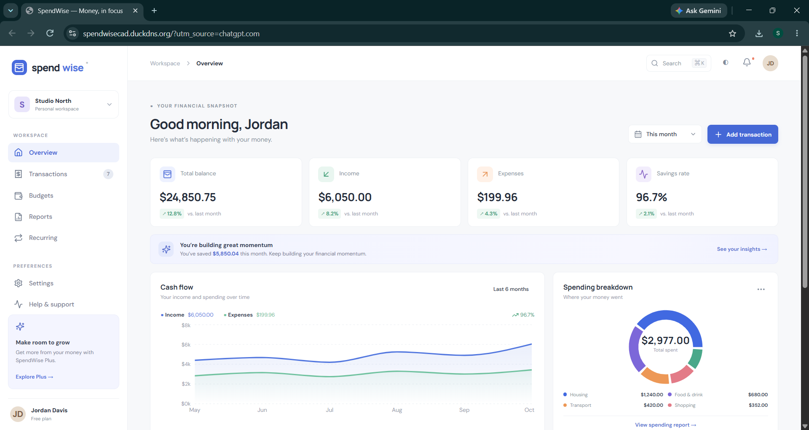
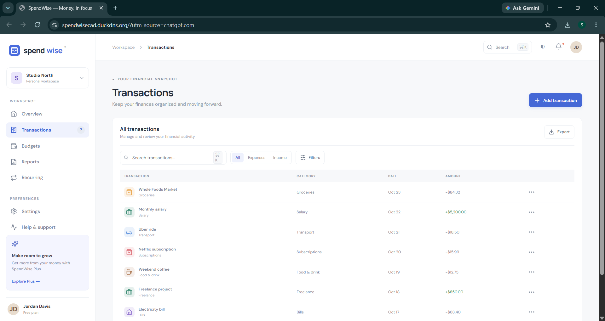
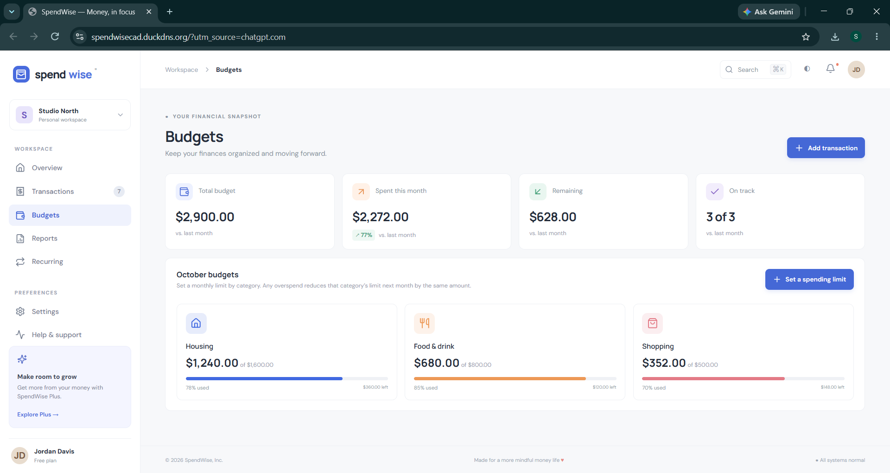

# SpendWise – Full-Stack Expense Management Application

**SpendWise** is a full-stack expense management application built to help users track income and expenses, analyze spending patterns, manage budgets, and monitor financial activity through an interactive dashboard.

🚀 **Live Demo:** <https://spendwisecad.duckdns.org>  
💻 **GitHub:** <https://github.com/sakthiyogeswaran11/spendwise-expense-management>

---

## 📌 Project Overview

SpendWise was developed as a production-style full-stack application using **React.js, Node.js, Express.js, and PostgreSQL**.

The project includes secure authentication, REST APIs, database persistence, financial analytics, responsive UI, automated testing, Docker support, and AWS deployment.

The application is deployed on **AWS EC2** with **Nginx, PM2, PostgreSQL, HTTPS, and a DuckDNS domain**.

---

## 📸 Screenshots

### Dashboard

The dashboard provides an overview of income, expenses, balance, savings rate, cash flow, and spending categories.



### Transactions

The transactions page allows users to view, search, filter, and manage their financial transactions.



### Budgets

The budgets page provides category-based spending limits, usage tracking, and remaining budget insights.



## ✨ Key Features

- 🔐 User registration and secure authentication
- 💰 Income and expense management
- 📊 Interactive financial dashboard
- 📈 Category-based expense analytics
- 🔎 Transaction search and filtering
- 📄 CSV transaction export
- 💳 Budget tracking
- 🔄 Recurring payment overview
- 👤 User profile management
- 🌙 Dark mode
- 📱 Responsive design
- ♿ Accessible and keyboard-friendly interface
- 🛡️ Password hashing and secure authentication
- 🚦 API rate limiting
- 🧩 Input validation with Zod
- 🗄️ PostgreSQL database with user-level data isolation

---

## 🛠️ Technology Stack

### Frontend

- React.js
- JavaScript
- Vite
- Recharts
- Lucide Icons
- CSS

### Backend

- Node.js
- Express.js
- REST API
- Zod
- bcrypt
- JWT

### Database

- PostgreSQL
- Parameterized SQL queries
- Database migrations

### DevOps & Deployment

- AWS EC2
- Ubuntu Linux
- Nginx
- PM2
- Docker
- Docker Compose
- GitHub Actions
- Let's Encrypt / HTTPS
- DuckDNS

---

## 🏗️ Application Architecture

```text
                    ┌─────────────────────┐
                    │       User          │
                    └──────────┬──────────┘
                               │
                               ▼
                    ┌─────────────────────┐
                    │       Nginx         │
                    │  HTTPS / Reverse    │
                    │       Proxy         │
                    └──────────┬──────────┘
                               │
                    ┌──────────┴──────────┐
                    │                     │
                    ▼                     ▼
             ┌──────────────┐      ┌──────────────┐
             │ React + Vite │      │ Express API  │
             │   Frontend   │      │   + PM2      │
             └──────────────┘      └──────┬───────┘
                                          │
                                          ▼
                                  ┌──────────────┐
                                  │ PostgreSQL   │
                                  │   Database   │
                                  └──────────────┘
```

---

## 🔐 Security

Security was considered throughout the application:

- Passwords protected using **bcrypt**
- JWT-based authentication
- HTTP-only authentication cookies
- Secure cookies in production
- SameSite cookie protection
- Zod request validation
- Express rate limiting
- Helmet security headers
- Parameterized SQL queries
- User-scoped database queries
- Environment variables for sensitive configuration
- Production HTTPS using TLS

**Production secrets and `.env` files are excluded from Git using `.gitignore`.**

---

## ☁️ AWS Deployment

The application is deployed on an **AWS EC2 Ubuntu server**.

### Deployment Components

```text
AWS EC2
│
├── Ubuntu Linux
├── Node.js
├── PostgreSQL
├── PM2
│   └── SpendWise API
│
└── Nginx
    ├── HTTPS / SSL
    ├── React frontend
    └── /api → Express backend
```

### Deployment Technologies

- AWS EC2
- Ubuntu 24.04
- Node.js
- PostgreSQL
- PM2
- Nginx
- Let's Encrypt SSL
- DuckDNS
- Git

The application is accessible through:

**<https://spendwisecad.duckdns.org>**

---

## 📂 Project Structure

```text
spendwise/
│
├── .github/
│   └── workflows/
│       └── ci.yml
│
├── nginx/
│   └── spendwise.conf
│
├── server/
│   ├── migrations/
│   │   └── 001_initial.sql
│   │
│   ├── src/
│   │   ├── db.js
│   │   ├── index.js
│   │   ├── middleware.js
│   │   ├── money.js
│   │   └── routes/
│   │       ├── auth.js
│   │       ├── budgets.js
│   │       └── transactions.js
│   │
│   ├── migrate.js
│   ├── seed.js
│   └── test/
│
├── src/
│   ├── App.jsx
│   ├── Auth.jsx
│   ├── main.jsx
│   └── styles.css
│
├── Dockerfile
├── docker-compose.yml
├── package.json
├── vite.config.js
├── DEPLOYMENT.md
└── README.md
```

---

## 🚀 Run Locally

### 1. Clone the repository

```bash
git clone https://github.com/sakthiyogeswaran11/spendwise-expense-management.git
cd spendwise-expense-management
```

### 2. Install dependencies

```bash
npm install
```

### 3. Configure environment variables

Create a `.env` file based on `.env.example`.

Configure:

```env
NODE_ENV=development
PORT=4000
DATABASE_URL=your_postgresql_connection_string
JWT_SECRET=your_secure_jwt_secret
JWT_EXPIRES_IN=7d
FRONTEND_URL=http://localhost:5180
COOKIE_SECURE=false
```

### 4. Run database migration

```bash
node server/migrate.js
```

### 5. Seed development data

```bash
node server/seed.js
```

### 6. Start the application

```bash
npm run dev
```

Frontend:

```text
http://localhost:5180
```

API:

```text
http://localhost:4000
```

---

## 🐳 Docker

The project also supports Docker Compose.

```bash
docker compose up --build
```

For a fresh database:

```bash
docker compose exec app node server/migrate.js
```

---

## 🔌 REST API

| Method | Endpoint | Purpose |
| --- | --- | --- |
| POST | `/api/auth/register` | Create account |
| POST | `/api/auth/login` | Authenticate user |
| POST | `/api/auth/logout` | End session |
| GET | `/api/auth/me` | Get user profile |
| PATCH | `/api/auth/me` | Update profile |
| GET | `/api/transactions` | Get transactions |
| POST | `/api/transactions` | Create transaction |
| PATCH | `/api/transactions/:id` | Update transaction |
| DELETE | `/api/transactions/:id` | Delete transaction |
| GET | `/api/transactions/analytics/summary` | Financial analytics |
| GET | `/api/health` | API health check |

---

## 🧪 Testing & CI

The project includes automated testing and a GitHub Actions workflow.

### Run tests

```bash
npm test
```

### Build frontend

```bash
npm run build
```

The CI workflow validates the project through automated tests, frontend build, and Docker image build.

---

## 📈 What I Learned

This project helped me strengthen my practical skills in:

- Full-stack application development
- React component development
- REST API design
- PostgreSQL database management
- Authentication and authorization
- Secure backend development
- Git and GitHub
- Linux server administration
- AWS EC2 deployment
- Nginx reverse proxy configuration
- HTTPS and SSL configuration
- PM2 process management
- Docker
- CI/CD fundamentals

---

## 🔮 Future Improvements

Planned improvements include:

- Complete dashboard integration with live transaction APIs
- Full budget CRUD functionality
- Recurring transaction automation
- Category management
- Refresh-token rotation
- MFA authentication
- Email notifications
- OpenAPI documentation
- Additional integration testing
- AI-powered spending insights

---

## 👨‍💻 Developer

**Sakthiyogeswaran**

BSc Information Technology | Full-Stack Developer

Interested in building scalable web applications using **React, Node.js, PostgreSQL, and AWS**.

---

## ⭐ Project Highlights

**React.js + Node.js + PostgreSQL + AWS EC2 + Nginx + PM2 + Docker + GitHub Actions**

Built, tested, secured, and deployed as a complete full-stack application.
